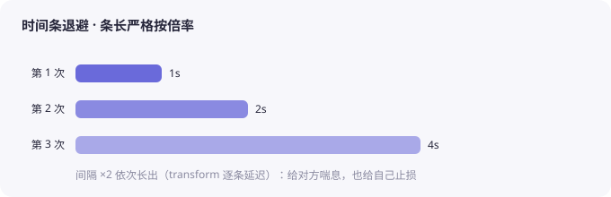
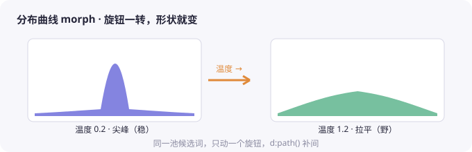
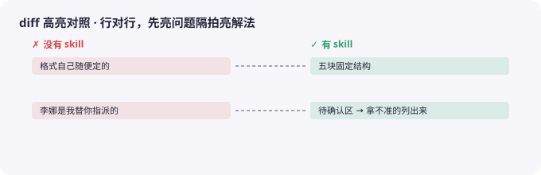
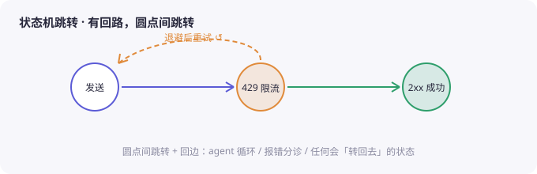

# 可播放动画流程选型

**默认只做「可播放动画流程」：读者按播放，看见一个过程。**
不用点选、拖拽、押注、排序——这些旧互动题型仍留在 `assets/patterns/`，但**默认不用**；只有用户明确要「可点 / 可拖 / 可押」时才回查（见文末附录）。

---

## 一、四种叙事结构

| 内容性质 | 判据 | 动画结构 | 心理机制 | 实现 |
|---|---|---|---|---|
| **一个过程 / 流程** | 有输入、处理、输出；读者没见过它怎么跑 | **单线流程播放**：输入 → 处理 → 输出，代价帧放慢 | 见证 | `patterns/06` / `14` |
| **一组前后结果** | 两个结果都在，差别只在一处 | **前后对照播放**：只改一处，结果翻转 | 对比 + 因果 | `patterns/15` |
| **有多步决策链** | 错误不立刻报错，几步后才显形 | **分支流程播放**：走一条路，几步后看到后果 | 因果体验 | `patterns/13`（改播放版） |
| **分层 / 逐层展开** | 内容有整体与细节，需要逐层点亮 | **逐层展开播放**：从整体到细节，逐节点出现 | 见证 + 结构感 | `patterns/03` / `14` |

**选错的典型**：
- 把一个静态结论硬做成流程 → 读者看完不知道重点；
- 把有对错的内容做成纯播放 → 读者没有参与感；
- 一页塞两个过程 → 每段都播不完。

---

## 一·补、形式二选一：线性五拍（切换式）vs 全图流程图（逐节点点亮）

同一种叙事结构可以落成两种播放形式，**一页选一种，不要混**：

| 形式 | 舞台行为 | 适合 | 实现 / 参考 |
|---|---|---|---|
| **线性五拍（切换式）** | 每拍整屏替换，同屏只有一拍（红线 16 只约束这种） | 每拍自带一块正文 / 示意区的机制讲解 | `patterns/06`、`patterns/14` 的横向步进链变体（`.anim-step` + `.cap`） |
| **全图流程图（不是五拍）** | 一张完整 SVG **常驻不换屏**，播放按时间轴**逐节点 / 逐箭头点亮**（`.on` 累加），底部字幕条跟拍 | 一条可走的链路 + 条件分支 / 回路，读者要一次看全系统流向 | `patterns/14` 主形态；成页 donor：`Skill微PBL1.1-01-为什么AI记不住上周的交代-学习页.html`（Obsidian 老师课程资料汇总/Skill微PBL/学习页/） |
| **对话气泡流** | 气泡逐条冒出**只增不减** + 窗口线渐满，旧气泡只能降透明不能消失 | 多轮对话 / 上下文堆积 / 为什么聊久会忘 | `patterns/16` |
| **时间条退避** | 变长条形按倍率逐条长出（1s/2s/4s），严格按倍率定宽 | 递增的等待 / 成本 / 消耗（指数退避、计费、Token） | `patterns/17`；可独立也可嵌进五拍示意区（纯 CSS 版） |
| **diff 高亮对照** | 两栏行对行，差异行先亮左（问题）隔拍亮右（解法），累加 | 两份产出行级对照（有/没 skill、改前后） | `patterns/18`；与 `fix-cmp` 静态两栏二选一，别同页重复 |
| **分布曲线 morph** | 曲线 SVG 常驻，随拍 `d:path()` 补间变尖 / 拉平 + 抽中点显隐 | 温度 / Top-P 这类「旋钮一转，分布形状就变」 | `patterns/19`；成页 donor：`智谱1.2.3-同一个问题为什么每次答案不一样-学习页.html`（`~/Desktop/智谱1.2html页面/`） |

全图流程图（donor 页 1.1-01 实测）的三个要点：

1. **点亮是累加的**：第 N 步不撤第 N−1 步的 `.on`，图越播越完整；终态 = 全图点亮 + 一句收束字幕。静态图先能读，动画只加注意力。
2. **时间轴用 rAF 累计**（`elapsed = base + now - startedAt`），每步 `{t, on:[节点,箭头,标签], text}`；暂停 / 继续天然无损（暂停时 `base += now - startedAt`）。比 setTimeout 队列好续。
3. **窄屏**：SVG `min-width:760px` + `.anim-scroll` 卡内横滚（页面级不溢出）；`prefers-reduced-motion` 直接 `finalState()` 全亮 + 收束字幕。

### 六种形式小样图（`assets/patterns/samples/`）

六张 SVG 小样图**就是红线 17 说的「六种形式」菜单**（① 对话气泡流 · ② 计数器滚动 · ③ 时间条退避 · ④ 分布曲线 morph · ⑤ diff 高亮对照 · ⑥ 状态机跳转），**动手写 pattern 前先看一眼小样确认形式**；图是静态示意，实际页面照 pattern 文件的骨架做成可播放。上面那张表里的「线性五拍 / 全图流程图」是**承载形态**，不算这六种之一——六种里只有 ⑥ 用节点行。

**① 对话气泡流**（`patterns/16`）——气泡逐条冒出只增不减 + 窗口线渐满：

**② 计数器滚动**（暂无 pattern 文件，rAF 补间数字即可，成本最低）——数字从 0 滚到目标 + 一句「为什么停不下来」：

**③ 时间条退避**（`patterns/17`）——条长严格按倍率，逐条长出：

**④ 分布曲线 morph**（`patterns/19`）——旋钮一转，曲线在尖峰与拉平之间补间：

**⑤ diff 高亮对照**（`patterns/18`）——行对行，先亮左（问题）隔拍亮右（解法）：

**⑥ 状态机跳转**（暂无 pattern 文件，全图流程图 `patterns/14` 的近亲：节点圆 + 正向箭头 + 回边 ↺）——有回路的状态用这个：

> ②⑥ 还没有独立 pattern 文件：② 用 rAF 对数字做补间（十几行），⑥ 照 `patterns/14` 的点亮机制把节点画成圆即可。哪一种先被真页用上，就把成页 donor 路径标进对应 pattern 头部（照 14 的规矩）。

---

## 一·补二、六选一决策：先问「这一页真正在变的是什么」（硬约束 · 红线 17）

**形式不许靠惯性选，也不许多页沿用同一个。** 每页在 Phase 1 就要从下面六种里挑定一种，并写下「为什么是它」——一句话，写在诊断清单里。

判断只有一个动作：**别先看你觉得哪种好看，先问这一页真正在变的是什么。** 变的那个东西决定了形式，形式再决定节奏。

| 这一页真正在变的 | 形式 | 内容里会出现这些词 / 画面 | 实现 |
|---|---|---|---|
| **对话轮次在累加，越聊越挤** | ① 对话气泡流 | 两轮以上往来、「聊到第 5 轮它就忘了」、上下文 / 记忆 / 越聊越贵 | `patterns/16` |
| **一个数字从 0 涨到很大** | ② 计数器滚动 | 结论落在一个量级数字上：×100、几十万 Token、一个月多少钱 | 无 pattern，rAF 补间（十几行） |
| **等待 / 成本按倍率往上翻** | ③ 时间条退避 | 1s → 2s → 4s、重试、退避、限流、按秒计费 | `patterns/17` |
| **调一个旋钮，形状变了** | ④ 分布曲线 morph | 温度、Top-P、采样、稳定 / 发散、曲线变尖或拉平 | `patterns/19` |
| **两份产出只差几行** | ⑤ diff 高亮对照 | 改前 / 改后、有 skill / 没 skill、正确 / 错误两份文本并排 | `patterns/18` |
| **状态之间来回跳，有回路** | ⑥ 状态机跳转 | 重试、回到上一步、卡在循环里、成功 / 失败 / 重来 | 照 `patterns/14` 的点亮机制画圆节点 |

**选的时候守三条：**

1. **命中哪一条就用哪一条**，不必先问「这页是不是流程」。六种里只有 ⑥ 有节点行，①–⑤ 根本不是五拍：硬套五拍会把好内容做废。
2. **六种都不贴才回落**到单线流程（`06` / `14`）或前后对照（`15`）——前提是**为了套六种就得改内容**。回落要在诊断里写一句「为什么六种都不合适」，不写就是偷懒。
3. **同一批多页，相邻两页不许用同一形式**。内容性质真的相同（比如一组三页都在讲同一个递增成本）也要写明理由，否则换形式。

**反例（最常见的一种）**：一页讲「为什么聊久了 AI 会忘」，内容明明是轮次在堆，却做成五拍节点行 + 字幕，读者看不出「只增不减」——换成 ① 对话气泡流，气泡一条条冒出来、窗口线渐满，机制自己就长在画面上。

**交付时带一句**：这页为什么用这种形式（一句话，写进诊断结论回顾）。

---

## 二、通用装配要求（四种结构都要满足）

| 要求 | 说明 |
|---|---|
| **过程可见** | 动画必须展示一个变化 / 流程，不是一张静态配图。读者看完要能说出「先发生什么、后发生什么」。 |
| **自带解释** | 每一拍都有字幕 / 标注，说明「这一步发生了什么、为什么变」。**不另开原理卡**；动画本身就是原理。 |
| **可播放 / 暂停 / 重播** | 一个播放按钮：播放中变「暂停」，结束后变「↻ 再看一遍」。不要只给一次播放。 |
| **进入视野自动播一次** | 用 `IntersectionObserver`，滚到该处才播；加载即播会导致读者滚到时已经播完。 |
| **可打断** | 暂停 / 重播前必须 `clearTimeout` 清空定时器，否则两轮步骤叠在同一条时间线上。 |
| **reduced-motion** | `R()` 返回 0；所有步骤直接显示终态，不播动画。 |
| **不记分** | 动画不是测验，不做进度条 / 命中率 / 对错反馈。 |
| **收尾判词** | 动画结束后给一句结论 / 判词，把「看到了什么」翻译成「所以呢」。 |

---

## 三、节拍：不匀速，代价帧放慢

| 片段 | 给多久 | 为什么 |
|---|---|---|
| 开场 | 短（~900ms） | 快进到现场 |
| 普通步骤 | 中（~550ms） | 看得清就行 |
| **代价 / 后果帧** | **长（900–1200ms）** | 这是让读者产生自省的帧 |
| 收尾 / 判词 | 最长（~300ms 后定格） | 留给回味 |

- **单线流程**：把「不做会怎样」的代价帧放慢。
- **前后对照**：坏结果那一侧多停一拍，好结果收尾定格。
- **分支流程**：爆点帧 800–1200ms，留空档让读者反应。
- **逐层展开**：每层点亮后停 550ms，别一口气全亮。

---

## 四、时长参考

| 动画规模 | 总时长 | 控件 |
|---|---|---|
| 3–5 步 | 2–3 秒 | 播放 + 重播 |
| 5–9 步 | 5 秒内 | 播放 + 暂停 + 重播 |
| 3 层 × 3 步 | 分段，可跳 | 播放 + 暂停 + 重播 + 层切换 |

超过 3 秒的动画必须给「↻ 再看一遍」；超过 10 秒才值得加「单步 / 重置」。

---

## 五、收尾：先给结论，再给边界

动画结束后，用一句话收住：

1. **给结论**：刚才这个过程说明了什么（一句话）。
2. **给边界**：它在什么情况下不成立（写进页底「知识总结」的上半段，不要塞回动画里）。
3. **给动作**：读者今天能拿它做什么（写进 takeaway 第 4 条）。

---

## 六、体量：动画区不许吃掉半屏

动画是页面**中间的一段**，不是整页。整块装置（标题行 + 流程图 + 字幕 + 播放键 + 演示说明）在 1280×800 下**不超过 450px**（约 55% 视口）；手机上不超过视口高度的 45%。各拍叠在同一个网格单元里、容器高度取最高一拍——**切换式换拍（红线 16）：同屏永远只有一拍，不跳版，也不把多拍叠在一屏**。

> **手机上 45% 这一条只对「同屏一拍」的切换式成立。** 全图类（流程图 / 漏斗 / 矩阵）在终态要同时显示整张图 + 判词 + 演示说明，45%（375×760 上是 342px）结构上做不到——实测把标题行、判词、说明全部收紧后仍在 410–500px。这类形态的**可达目标改成「整块 ≤1 屏」**（320×568 下整块 <568px，不必滚动才能看全）。要往 45% 靠，只能换形态（改成同屏一拍的切换式），不是继续压字号。

| 部件 | 上限 | 做法 |
|---|---|---|
| 节点行 | 桌面 ≤100px；≤760px ≤56px | 节点只放「编号 + 2–4 字动作 + 一行术语」；长标题和正文**全部**搬进字幕面板 |
| 单拍字幕 | ≤200px；**权重条类示意 ≤230px** | 标签 1 行 + 标题 1 行 + 正文 ≤3 行 + 示意区：词块**一行**，或权重条 **≤5 行**（每行内容 ≤17px、行距 ≤3px）。5 行以上就说明该砍词，不是砍字号 |
| 播放键 | **不独占一行** | 放进装置标题行右侧（`demo-head` 右端），和进度文字同一组 |
| 演示说明 | ≤2 行（宽屏尽量压到 1 行） | 只留「教学示意 / 不代表真实数值」这类边界话；`max-width` 给到 70em 以上，别让它折成两行白占 20px |
| 窄屏 | **横向小链，不竖排** | 5 个节点挤成一条（每格 ~57px、隐藏英文名）；竖排 5 个节点白占 250px 高度 |

三条硬线：

1. 正文超过 3 行 → **删字**，不要缩字号（缩到 13px 就变成注释，读者会跳过）。
2. 节点超过 6 个 → 合并成 5 个，或分两段播（分两段要各配一句字幕，不许连着播）。
3. 字幕面板高过节点行 2 倍 → 说明字幕在替图说话，回去砍正文、把细节留给知识卡片。

> 反例（改前）：五拍各做一张带正文的卡片竖排，整块 700px+，一屏只能看见动画，看不见下面的三问卡。
> 改法：图只留节点，正文挪进字幕面板，播放键挪进标题行 → 同样的内容 533px → 423px。

---

## 七、交互：默认自动播，但节点也能点

- **进入视野自动播一次**（`IntersectionObserver`，`threshold` 0.35）：滚到才播，不加载即播。
- **每个节点可点**：点哪一拍就停在那一拍，按钮变成「▶ 继续」，从下一拍接着播；不重置进度、不弹提示。
- **语义要真**：节点 `role="button" tabindex="0" aria-label="第 N 拍：<动作>"`，Enter / 空格同效，`:focus-visible` 有描边。不要只在 `div` 上挂 `onclick`。
- **切换而不是叠加**（红线 16，只约束线性五拍形式）：显示哪拍就只亮哪拍（`.show` 独占，其余拍全部撤掉），**前面的拍不同屏补齐**——同屏永远只有一拍。位置感交给进度点 / 进度文字。**全图流程图形式相反**：点亮累加不撤销（见「一·补」）。
- **三态必须分得开**：还没走到（虚线空位）/ 已走过（实线 + 实心编号）/ 正在这一拍（强调色 + 浅底）。有跳转就必须有「当前拍」。
- 点完再点播放键 = 从下一拍继续；跳转时把收尾判词藏起来（`verdict.hidden = true`），别让结论提前出现。

---

## 附录：旧互动题型（默认不用）

`01` 点选计数器 · `02` 滑块对照 · `03` 分步推进 · `04` 盲判核对 · `05` 自诊分层 · `07` A/B 对比 · `08` 归类分堆 · `09` 排序 · `10` 拼装 · `11` 找错 · `12` 预算分配 · `13` 分支选择。

**只在用户明确要求「可点 / 可拖 / 可押」时使用**；默认页面主块是可播放动画流程。旧题型的实现文件仍在 `assets/patterns/`，不要删。
